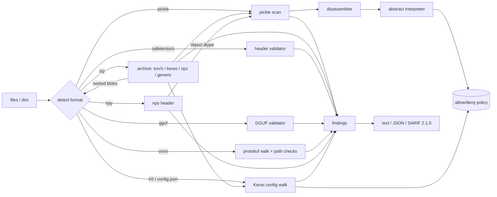

# picklescope

**A static scanner for ML model files that never deserializes them.**

[](https://github.com/lutherleo/picklescope/actions/workflows/ci.yml)

picklescope inspects PyTorch checkpoints, raw pickles, NumPy arrays, Keras archives,
safetensors, GGUF and ONNX files *before* anything loads them. It disassembles pickle
bytecode and replays the unpickler's stack machine over abstract values, so it knows
which callables a file would import and call without importing or calling anything.
Every import is checked against an allow-list policy. The other formats get
structural validation aimed at the documented attacks on each one. Results come out
as text, JSON or SARIF 2.1.0.

```console
$ picklescope scan tests/fixtures/torch/benign_state_dict.pt tests/fixtures/torch/print_in_data_pkl.pt
picklescope 0.1.0 - policy default

tests/fixtures/torch/benign_state_dict.pt  [zip:torch, 612 B]  ok
tests/fixtures/torch/print_in_data_pkl.pt  [zip:torch, 531 B]
  HIGH     PKL102 [archive/data.pkl] @19 invokes builtins.print('hello from a picklescope fixture') which is not on the allow-list

2 file(s) scanned, 0 skipped, 1 with medium-or-higher findings
findings: critical 0, high 1, medium 0, low 0, info 0
```

> Defensive and educational. Every hostile-looking test fixture is built in this repo
> from harmless callables (`print`, `len`, `str.upper`, `os.getcwd`, `colorsys`), and
> a test fails if any fixture references anything else. No fixture is ever loaded.

## Why

`torch.load`, `pickle.load`, `joblib.load`, `numpy.load(allow_pickle=True)` and
`keras.models.load_model(safe_mode=False)` can all run code embedded in the file. Model
hubs distribute these files at scale. Popular open-source scanners rely mainly on
deny-lists of dangerous imports, and published bypasses have repeatedly used a module the list did
not include. picklescope takes the opposite approach:

* **allow-list first.** A torch state dict needs about a dozen references. Anything
  else is reported, and a deny-list only raises the severity of known primitives.
* **Semantics, not grep.** Memo-routed `STACK_GLOBAL` operands, computed imports,
  `getattr(...)(...)` gadget chains, `BUILD` on imported classes, pickles hidden in
  `bytes` constants and second pickles after `STOP` are all modelled.
* **One tool for the formats people actually ship.** The pickle analysis is not
  enough on its own. Keras configs can name arbitrary functions, GGUF chat templates
  are Jinja, ONNX external data is a file path, and safetensors headers can be
  crafted into polyglots.
* **Zero runtime dependencies.** The scanner uses only the standard library and
  imports no deserializer. An AST test enforces that.

Who it is for: ML platform and security engineers who gate model downloads in CI,
model-hub and registry operators, and anyone who wants to see what a `.bin` file would
do before running it.

## What it checks

| Format | Detection | Highlights | Rules |
|---|---|---|---|
| Pickle (protocols 0-5) | `\x80` prologue, text-protocol heuristics for pickle extensions | allow/deny policy on every import, invoked vs. imported, dynamic `STACK_GLOBAL`, `EXT*`, indirect calls, global mutation, persistent ids, nested and multiple pickles, malformed streams | `PKL100`-`PKL116` |
| PyTorch zip / TorchScript | `<prefix>/data.pkl` | every `*.pkl` member scanned, storage keys checked against records, `code/` reported, storages never decompressed | `ZIP206`, `ZIP207` |
| Legacy `torch.save` | magic number in the first pickle | five-pickle layout, persistent ids allowed | - |
| Any zip | `PK\x03\x04` | zip-slip, duplicates, symlinks, encryption, bombs, embedded `.so`/`.py`, recursive scan of nested zip/npy/GGUF/pickle members | `ZIP200`-`ZIP208` |
| NumPy `.npy` / `.npz` | `\x93NUMPY` | header validation; object arrays scanned as pickles | `NP700`, `NP701` |
| Keras v3 `.keras`, KerasHub `config.json`, legacy `.h5` | archive layout / config shape / HDF5 magic | Lambda layers (bytecode), `module`/`class_name` references checked with the same policy (CVE-2025-1550 class), custom objects | `KR600`-`KR604` |
| safetensors | length prefix + `{` | reference-loader validation (header cap, dtype, shape, exact tiling) plus duplicate JSON keys and appended data | `ST300`-`ST308` |
| GGUF v1-v3 (LE/BE) | `GGUF` | bounds-checked header/KV/tensor table, implausible counts, dims, types, alignment, overlaps, block sizes, Jinja SSTI patterns in chat templates (CVE-2024-34359 class) | `GG400`-`GG415` |
| ONNX | `.onnx` + protobuf | external-data paths (absolute, `..`, symlink escape, missing, out of range) across graphs, sub-graphs, functions; custom op domains | `OX500`-`OX506` |
| All | - | extension/content mismatch, zip polyglots, size limits, contained parser errors | `GEN900`-`GEN903` |

The full rule catalogue with rationale is in [docs/RULES.md](docs/RULES.md).

## Architecture



The details are in [docs/ARCHITECTURE.md](docs/ARCHITECTURE.md): the abstract
interpreter, mark and memo semantics, per-format algorithms and their complexity. How
the policy is built and how to extend it is in [docs/ALLOWLIST.md](docs/ALLOWLIST.md).
The threat model is in [docs/THREAT_MODEL.md](docs/THREAT_MODEL.md).

## Quick start

Requires Python 3.12 and [uv](https://docs.astral.sh/uv/).

```console
$ uv sync
$ uv run picklescope scan path/to/model.bin path/to/dir/
$ uv run picklescope scan -f sarif -o results.sarif models/      # for GitHub code scanning
$ uv run picklescope scan -f json --show-imports model.pt          # full import inventory
$ uv run picklescope disasm model.pt --member archive/data.pkl     # annotated disassembly
$ uv run picklescope policy check torch:Size os:system             # explain a decision
$ uv run picklescope scan --policy my-policy.toml --profile sklearn models/
$ uv run picklescope rules                                         # rule catalogue
```

The exit code is `0` when nothing reaches `--fail-on` (default `medium`), `1` when
something does, and `2` on usage or policy errors.

Library use:

```python
from picklescope import Severity, scan_paths
from picklescope.output import to_sarif

report = scan_paths(["model.bin"])
if report.exceeds(Severity.HIGH):
    raise SystemExit("refusing to load model")
```

## Demo

`make demo` runs the CLI over the bundled fixtures, entirely offline. This is an
excerpt of a real run:

```text
$ picklescope scan --no-hash --show-imports tests/fixtures/torch/benign_state_dict.pt tests/fixtures/torch/print_in_data_pkl.pt
picklescope 0.1.0 - policy default

tests/fixtures/torch/benign_state_dict.pt  [zip:torch, 612 B]  ok
  imports: collections.OrderedDict (allow), torch.FloatStorage (allow), torch._utils._rebuild_tensor_v2 (allow)
tests/fixtures/torch/print_in_data_pkl.pt  [zip:torch, 531 B]
  HIGH     PKL102 [archive/data.pkl] @19 invokes builtins.print('hello from a picklescope fixture') which is not on the allow-list
  imports: builtins.print (unknown)

2 file(s) scanned, 0 skipped, 1 with medium-or-higher findings
findings: critical 0, high 1, medium 0, low 0, info 0

$ picklescope scan --no-hash tests/fixtures/pickle/getattr_gadget.pkl tests/fixtures/pickle/stack_global_memo.pkl tests/fixtures/pickle/nested_pickle.pkl tests/fixtures/pickle/two_pickles.pkl tests/fixtures/pickle/dunder_traversal.pkl
picklescope 0.1.0 - policy default

tests/fixtures/pickle/getattr_gadget.pkl  [pickle, 51 B]
  CRITICAL PKL100 @2 invokes deny-listed builtins.getattr (attribute-gadget: reads or writes arbitrary attributes, enabling gadget chains)
  HIGH     PKL106 @49 REDUCE calls a runtime-computed object: builtins.getattr(builtins.str, 'upper')(...)
tests/fixtures/pickle/stack_global_memo.pkl  [pickle, 43 B]
  HIGH     PKL102 @27 invokes builtins.print('memo route') which is not on the allow-list
tests/fixtures/pickle/nested_pickle.pkl  [pickle, 45 B]
  HIGH     PKL102 [embedded@2] @19 invokes builtins.print('nested hello') which is not on the allow-list
  MEDIUM   PKL109 @2 bytes constant of 37 bytes is itself a pickle; scanned as tests/fixtures/pickle/nested_pickle.pkl!embedded@2
tests/fixtures/pickle/two_pickles.pkl  [pickle, 115 B]
  HIGH     PKL102 @77 invokes builtins.print('hello from a picklescope fixture') which is not on the allow-list
  MEDIUM   PKL110 @58 stream continues with another pickle after STOP; repeated load() calls execute it
tests/fixtures/pickle/dunder_traversal.pkl  [pickle, 35 B]
  HIGH     PKL104 @33 import of colorsys.rgb_to_hsv.__code__ walks dunder attributes
  MEDIUM   PKL101 @33 imports colorsys.rgb_to_hsv.__code__ which is not on the allow-list

5 file(s) scanned, 0 skipped, 5 with medium-or-higher findings
findings: critical 1, high 5, medium 3, low 0, info 0

$ picklescope disasm tests/fixtures/pickle/getattr_gadget.pkl
--- pickle at byte 0 (protocol 2) ---
       0: PROTO            2
       2: GLOBAL           'builtins getattr'                                              # import builtins.getattr -> deny
      20: GLOBAL           'builtins str'                                                  # import builtins.str -> allow
      34: SHORT_BINUNICODE 'upper'
      41: TUPLE2
      42: REDUCE                                                                           # call builtins.getattr
      43: SHORT_BINUNICODE 'abc'
      48: TUPLE1
      49: REDUCE                                                                           # call the result of builtins.getattr(builtins.str, 'upper')
      50: STOP

$ picklescope scan --no-hash tests/fixtures/keras/lambda.keras tests/fixtures/keras/function_denied.keras tests/fixtures/gguf/chat_template_dunder.gguf tests/fixtures/onnx/traversal.onnx tests/fixtures/safetensors/zip_polyglot.safetensors tests/fixtures/safetensors/pickle_in_disguise.safetensors
picklescope 0.1.0 - policy default

tests/fixtures/keras/lambda.keras  [zip:keras, 1.1 KiB]
  HIGH     KR600 [config.json] $.config.layers[1]: Lambda layer 'identity_lambda' carries serialized Python bytecode
tests/fixtures/keras/function_denied.keras  [zip:keras, 1.1 KiB]
  CRITICAL KR601 [config.json] $.config.layers[1].config.activation: function reference os.getcwd is deny-listed (process-execution)
tests/fixtures/gguf/chat_template_dunder.gguf  [gguf, 546 B]
  HIGH     GG411 @303 tokenizer.chat_template contains dunder attribute access
tests/fixtures/onnx/traversal.onnx  [onnx, 119 B]
  HIGH     OX502 @72 tensor 'w' external location '../outside.bin' contains a '..' segment
tests/fixtures/safetensors/zip_polyglot.safetensors  [safetensors, 239 B]
  HIGH     GEN903 file is a safetensors and also a valid zip archive
  MEDIUM   ST308 tensors end at byte 4 of the data section, short of its 175 bytes
tests/fixtures/safetensors/pickle_in_disguise.safetensors  [pickle, 57 B]
  HIGH     PKL102 @19 invokes builtins.print('hello from a picklescope fixture') which is not on the allow-list
  MEDIUM   GEN900 extension .safetensors implies safetensors but the content is pickle

6 file(s) scanned, 0 skipped, 6 with medium-or-higher findings
findings: critical 1, high 5, medium 2, low 0, info 0

$ picklescope scan --no-hash -f sarif -o out/demo.sarif tests/fixtures

out/demo.sarif: 93 artifacts, 90 results, by level {'error': 40, 'note': 3, 'warning': 47}
```

## Evaluation

All numbers below come from committed scripts. The raw results are in `eval/*.json`.

### False positives on pinned real models

`make eval` downloads 14 small public model files from fixed Hugging Face commits and
verifies each SHA-256 (see [DATA.md](DATA.md)). It then scans them with the default
policy. Every file is benign, so any finding at medium or above counts as a false
positive.

```console
$ make eval        # = scripts/fetch_models.py + scripts/eval_real_models.py + scripts/eval_fixtures.py
```

| Model file | Format | Size (bytes) | Findings | Imports seen |
|---|---|---|---|---|
| tiny-random-bert/pytorch_model.bin | zip:torch | 540,217 | 0 | collections.OrderedDict, torch.FloatStorage, torch.LongStorage, torch._utils._rebuild_tensor_v2 |
| tiny-random-bert/model.safetensors | safetensors | 520,212 | 0 | - |
| tiny-random-bert/onnx/model.onnx | onnx | 449,599 | 0 | - |
| tiny-random-gpt2/pytorch_model.bin | zip:torch | 3,561,811 | 0 | collections.OrderedDict, torch.ByteStorage, torch.FloatStorage, torch._utils._rebuild_tensor_v2 |
| tiny-random-gpt2/model.safetensors | safetensors | 453,864 | 0 | - |
| tiny-random-gpt2/tf_model.h5 | hdf5 | 8,462,256 | 0 | - |
| bert-tiny/pytorch_model.bin | zip:torch | 17,756,393 | 0 | collections.OrderedDict, torch.FloatStorage, torch.LongStorage, torch._utils._rebuild_tensor_v2 |
| stories260K-f32.gguf | gguf | 1,185,376 | 0 | - |
| stories260K.gguf | gguf | 1,185,376 | 0 | - |
| stories15M-q4_0.gguf | gguf | 19,077,344 | 0 | - |
| mmproj-tinygemma3.gguf | gguf | 1,039,072 | 0 | - |
| animal-classification/model_epoch_10.keras | zip:keras | 1,279,709 | 0 | 12 `keras.*` classes (Sequential, Conv2D, Dense, Adam, ...) |
| bert_tiny_en_uncased/config.json | keras-config | 454 | 0 | keras_hub...BertBackbone |
| bert_tiny_en_uncased/tokenizer.json | keras-config | 761 | 0 | keras.DTypePolicy, keras_hub...BertTokenizer |

**False-positive rate: 0/14 files (0.0%)**, from
`uv run python scripts/eval_real_models.py`. This sample is small, so it shows that
the default policy does not flag common, simple layouts. It does not measure the
false-positive rate across the hub. The allow-lists were written before these files
were scanned and were not changed afterwards.

Parser agreement on the same files is checked in `tests/test_real_models.py`. The
GGUF tensor names and data offsets match the reference `gguf` reader for all four
GGUF files. The ONNX node and tensor counts match `onnx.load`.

### Random benign pickles (held out)

`uv run python scripts/eval_fixtures.py` serializes 2,000 random values (seed
20261024; dicts, lists, tuples, sets, bytes, str, int, float, datetime, Decimal,
OrderedDict) at protocols 0-5. None of these were used during development.
**0/2000 were flagged at medium or above** (112,788 bytes in total).

### Synthetic corpus conformance

The same script checks the 93-file fixture corpus. **38/38 "malicious-pattern"
fixtures are reported at high or critical**, and every other fixture produces exactly
its expected rule set (`tests/test_fixtures.py`). The scanner was developed against
this corpus, so it is a conformance check and not an unbiased detection rate.

### Reference parity

* Disassembly matches `pickletools.genops` on property-generated pickles of nested
  values at protocols 0-5. The opcode table matches `pickletools.opcodes` (68 opcodes).
* safetensors validity agrees with the reference `safetensors` loader on every
  fixture. The one deliberate difference is `duplicate_key.safetensors`, which the
  reference accepts (last key wins) and picklescope reports as a parser differential.
* GGUF and ONNX fixtures are cross-checked against the `gguf` and `onnx` packages.

### Benchmarks

`make bench` (`scripts/bench.py`) reports the median of 5 runs. These numbers come
from macOS arm64, Python 3.12.13, on a machine that may be running other jobs, so treat
them as indicative:

| Workload | Result |
|---|---|
| Pickle analyser, protocol 2, 6.06 MiB / 1.9 M opcodes | 5.07 MiB/s, 1.59 M opcodes/s |
| Pickle analyser, protocol 4, 4.63 MiB / 1.9 M opcodes | 4.01 MiB/s, 1.65 M opcodes/s |
| Full scan of the fixture corpus (93 files) | 7.9 ms |
| `bert-tiny/pytorch_model.bin` (16.9 MiB, storages skipped) | 1.8 ms |
| `stories15M-q4_0.gguf` (18.2 MiB) | 16.2 ms |

Throughput depends on opcode density, not file size. A real checkpoint's `data.pkl`
is a tiny fraction of the archive, and tensor storage is never read.

### Tests and coverage

```console
$ make check   # ruff format --check, ruff check, mypy --strict, pytest with an 85% coverage gate
```

481 tests (465 run in a fresh clone; the 16 real-model tests skip until
`make fetch-models`). They cover golden findings for every fixture, a harmless-callable guard
on the corpus, property-based differential tests against `pickletools`, reference
parity, SARIF validation against the official OASIS JSON schema, CLI behaviour, and
fuzzing: random bytes plus 40 mutations of every fixture must never reach an internal
error. Line and branch coverage is **98.1%** (`make cov`).

## Design decisions

The full list of design decisions is in [DECISIONS.md](DECISIONS.md). The main ones:

* The opcode table and disassembler are written from scratch. `pickletools` is used
  only as a test oracle. This gives structured errors, resource limits, and no path
  into the unpickler.
* Mark and memo semantics follow CPython's C unpickler, so the abstract stack stays
  aligned with what a real `pickle.load` would do.
* Policy precedence is user deny > user allow > built-in deny > built-in allow.
  Python 2 spellings are checked both as written and after the `_compat_pickle`
  mapping.
* Allowed imports go into an import inventory, not into INFO findings, so SARIF stays
  quiet on clean checkpoints.
* ONNX is decoded straight from the protobuf wire format. External-data paths are
  resolved and checked for containment before any `stat` call.
* SARIF byte regions are emitted only for top-level offsets. Archive members are
  reported as `logicalLocations`.

## Limitations

* **Static modelling, not proof.** picklescope models the default CPython unpickler
  and `torch.load`. An application with a custom `find_class` or `persistent_load`
  can behave differently in either direction.
* **Allowed callables are trusted with any arguments.** The policy treats allow-listed
  reconstruction functions (NumPy, PyTorch rebuild helpers, `copyreg._reconstructor`)
  as safe for arbitrary arguments, relying on their callable arguments being imported
  and checked separately. A bug inside one of those functions would not be detected.
* **Unknown is not malicious.** Pickles of custom classes (`sklearn` without
  `--profile sklearn`, `transformers` `training_args.bin`, application objects) get
  medium or high findings until they are added to a policy file.
* **Coverage of formats is partial.** TensorFlow SavedModel, TFLite, joblib's
  interleaved format, compressed pickles, tar/7z, legacy GGML and Core ML are not
  parsed. Legacy Keras `.h5` configs are found with a byte-search heuristic, not an
  HDF5 parser. TorchScript code is reported but not analysed.
* **GGUF chat-template checks are pattern-based.** Novel template injections that
  avoid dunder access, `|attr` and the other listed constructs will be missed.
* **Small real-world evaluation.** 14 pinned files is a smoke test of the
  false-positive rate, not a survey of the hub. The fixture corpus is synthetic and
  was used during development.
* **Model-level attacks are out of scope.** Backdoored weights, data poisoning and
  adversarial behaviour cannot be seen by a format scanner.

## Roadmap

* joblib support (model the interleaved array payloads instead of stopping at them).
* A minimal HDF5 superblock and attribute reader to replace the Keras `.h5` heuristic.
* TorchScript `code/` analysis: imports and `torch.ops` calls in the serialized Python.
* gzip/zlib-wrapped pickles and tar archives.
* A larger, regularly refreshed real-model false-positive survey across popular
  architectures, with per-library allow-list profiles (`transformers`, `timm`,
  `diffusers`).
* A pre-commit hook and a `huggingface_hub` download wrapper that refuses
  unsafe files.

## License

MIT, see [LICENSE](LICENSE).

## Maintainer

Originally published under the `lutherleo` GitHub account, picklescope is currently
maintained by **Love Kush Pranu**, a software developer with 3+ years of professional
experience.

- GitHub: [lutherleo](https://github.com/lutherleo)
- LinkedIn: [lovekush-pranu](https://linkedin.com/in/lovekush-pranu)
- Email: [lp2989@nyu.edu](mailto:lp2989@nyu.edu)