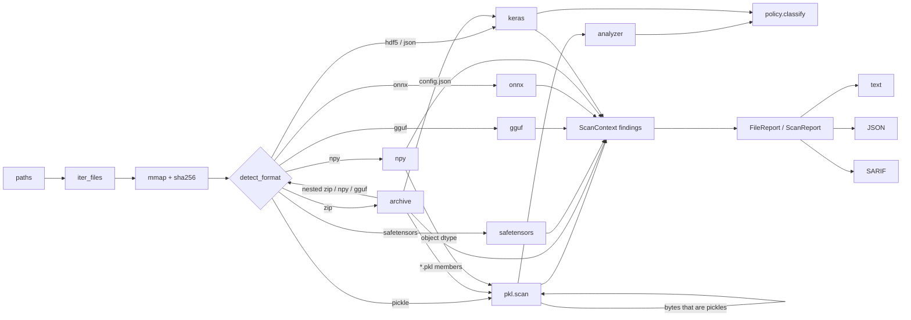

# Architecture

picklescope is a pure-Python (stdlib-only at runtime) static analyser. Every parser
reads untrusted bytes from a read-only memory map or an in-memory member buffer and
produces `Finding`s; nothing is imported, constructed, unmarshalled or evaluated.

## Module map

| Module | Responsibility |
|---|---|
| `scanner.py` | Walks paths, sizes/hashes files, detects formats, dispatches, converts crashes into `GEN901` findings. |
| `formats/detect.py` | Magic-byte detection, extension fallback for damaged files, extension/content mismatch (`GEN900`). |
| `blob.py` | Read-only `mmap` of input files (`Buffer = bytes | mmap`). |
| `context.py` | `ScanContext`: policy, limits, finding sink with per-rule flood cap, import inventory, nested-blob dispatcher with depth limit. |
| `pkl/opcodes.py` | Opcode table (68 opcodes, protocols 0-5) and argument decoders. |
| `pkl/disasm.py` | Streaming disassembler (`iter_ops`), pickle sniffing, listing renderer. |
| `pkl/analyzer.py` | Abstract interpreter: stack/mark/memo machine over abstract values, emits import/call/mutation/persistent-id/embedded-blob events. |
| `pkl/scan.py` | Multi-pickle streams, legacy torch layout, policy application, nested pickles. |
| `policy/` | Pattern language, decision procedure, built-in deny-list and allow profiles, TOML loader. |
| `formats/archive.py` | Zip containers: structural checks, layout classification (torch / torchscript / keras / npz / generic), member scanning, torch storage-reference checks. |
| `formats/safetensors.py` | Header validation and tiling check. |
| `formats/gguf.py` | GGUF v1-v3 (both byte orders) header, metadata and tensor-table checks; chat-template patterns. |
| `formats/protobuf.py`, `formats/onnx.py` | Wire-format decoder; ONNX walk over graphs, sub-graphs, functions; external-data path containment. |
| `formats/keras.py` | Keras config walk (Lambda, object references), legacy HDF5 config heuristic. |
| `formats/npy.py` | `.npy` header parsing and object-array pickle extraction. |
| `output/` | Text, JSON and SARIF 2.1.0 renderers. |
| `rules.py` | Rule catalogue (ids, default severities, rationale) shared by findings, SARIF and docs. |
| `cli.py` | `scan`, `disasm`, `policy check|show`, `rules`. |

## Data flow

## The pickle analyser

### Disassembly

`iter_ops(buf, start)` reads one opcode byte, looks it up in `OPCODES`, decodes the
argument with the reader for its `ArgKind`, and yields `Op(offset, info, arg, end)`
until `STOP`. Readers check every length against the remaining bytes before slicing,
so a hostile length field produces `PickleParseError("truncated")` instead of a large
allocation. Decoded values deliberately match `pickletools.genops`; the test suite
checks the opcode table and the disassembly of thousands of generated pickles
(protocols 0-5) against it.

*Complexity:* O(n) time in the stream length; O(1) extra space per opcode (arguments
are slices of the input).

### Abstract interpretation

`analyze_pickle` replays the unpickler's stack machine over abstract values:

| Value | Produced by |
|---|---|
| `Const(value)` | numeric/string/bytes opcodes, `NONE`, `NEWTRUE/FALSE` |
| `GlobalValue(module, name)` | `GLOBAL`, `INST`, `STACK_GLOBAL` with constant operands (`None, None` when dynamic) |
| `CallValue(callee, args)` | `REDUCE`, `NEWOBJ`, `NEWOBJ_EX`, `OBJ`, `INST` |
| `TupleValue(items)` | `TUPLE*`, `EMPTY_TUPLE` (items kept so call arguments can be shown) |
| `ContainerValue(kind)` | lists, dicts, sets (contents dropped) |
| `PersistentValue(pid)` | `PERSID`, `BINPERSID` |
| `ExtValue(code)` | `EXT1/2/4` |
| `BufferValue` | `NEXT_BUFFER` (protocol 5 out-of-band buffers) |

Marks are kept as a separate list of stack heights ("fences"), as in CPython's C
unpickler: popping below the current fence is an error, `POP` on an empty frame
discards the mark. The memo is a dict from index to abstract value, so
`STACK_GLOBAL` operands routed through `MEMOIZE`/`BINGET` are still resolved to
constants. The analyser emits:

* `ImportEvent` for each resolved import,
* `CallEvent` for each call (callee and argument values),
* `DynamicImportEvent` when `STACK_GLOBAL` operands are not constant strings,
* `MutationEvent` when `BUILD`, `SETITEM(S)`, `APPEND(S)` or `ADDITEMS` target an
  imported object rather than a fresh instance,
* `PersistentEvent` and `ExtValue` records,
* `EmbeddedBlob` for bytes constants (and latin-1 text constants, the protocol-2 bytes
  encoding) that begin with a protocol 2-5 pickle prologue.

The first structural problem (truncation, unknown opcode, stack underflow, memo miss,
protocol > 5, resource limit) stops the walk; everything gathered before it is kept
and reported.

*Complexity:* O(n) time. Space is O(n) in the worst case (stack and memo), bounded by
`max_stack_depth` and `max_memo_entries`; `max_pickle_ops` bounds time. Abstract tuples
can share structure through the memo, so `describe()` limits rendering depth.

### Streams with several pickles

After `STOP`, the scanner checks whether more bytes follow. If they start with a
pickle prologue or parse as a complete pickle, they are analysed too (`PKL110`), up to
`max_pickles_per_stream`; otherwise they are reported as trailing data (`PKL111`).
A first pickle whose value is the legacy `torch.save` magic number
`0x1950a86a20f9469cfc6c` switches to the legacy layout: exactly five pickles (magic,
protocol version, sys info, payload, storage keys) followed by raw storage bytes, with
persistent ids allowed.

## Containers

`archive.scan_zip` opens the central directory with `zipfile` (members are only
decompressed on demand, through a bounded `read(limit + 1)`). Structural checks run on
every entry: zip-slip names, duplicates, symlink mode bits, the encryption flag, and
declared size / compression ratio. The scan iterates the full `infolist()`, so every
copy of a duplicated name is read (findings in the k-th copy are located at
`name#k`): which copy a loader picks is implementation defined. Classification:

* `<prefix>/data.pkl` -> PyTorch; with `<prefix>/code/` -> TorchScript,
* root `config.json` plus `metadata.json`, `model.weights.h5` or `model.weights.npz`,
  or in a file named `*.keras`, or whose JSON is a Keras object (`class_name` +
  `config`) -> Keras v3. Keras parses `config.json` before it looks for weights, so
  no marker file is required for the config to be dangerous,
* only `*.npy` members -> `.npz`,
* otherwise a generic zip, whose members are sniffed (pickle prologue, zip, npy, GGUF
  magic) and dispatched recursively up to `max_nesting`.

For PyTorch archives, `<prefix>/data/*` storage records are never read. Persistent ids
from `data.pkl` must be `('storage', <imported class>, key, ...)` tuples whose `key` is a
plain record name present in the archive (`ZIP207`).

## Other formats

**safetensors** - read the u64 prefix, enforce `0 < N <= 100 MB` and `8 + N <= size`,
require `{`, parse JSON with an `object_pairs_hook` that records duplicate keys, validate
every entry (dtype table includes sub-byte F4/F6 types), then sort ranges and walk them
once to detect overlaps, holes and a data section that is too short or too long.
O(h + t log t) for header size h and t tensors.

**GGUF** - detect byte order from the version field, then read counts, KV pairs and
tensor infos through a bounds-checked reader. Before the loop, `n_kv x 13 + n_tensors x
24 bytes` (v2+) must fit in the file, which rejects absurd counts in O(1). Arrays check
`count x element_size <= remaining` before iterating. Tensor sizes come from the ggml
type table (block size, bytes per block); spans are sorted to find overlaps. Chat
templates are matched against a small set of regular expressions for Jinja constructs
that reach Python internals. O(header bytes + t log t).

**ONNX** - an iterative walk (explicit stack, no recursion) over
`ModelProto -> GraphProto -> NodeProto -> AttributeProto -> TensorProto`, including
sub-graphs, sparse tensors, functions and training graphs. Length-delimited fields are
returned as byte ranges, so nothing is copied until a string is needed. External-data
locations are checked lexically (absolute, `~`, drive letters, `..`, NUL) and, for files
on disk, by resolving the path and requiring it to stay under the model directory before
any `stat` call. O(model bytes) with depth capped by `max_protobuf_depth`.

**Keras** - the config JSON is walked iteratively. `Lambda` / `__lambda__` nodes are
reported once each; `{"module", "class_name"}` objects are classified with the import
policy plus the `keras` profile. Legacy HDF5 files are searched for `{"class_name"`
(at most 16 candidates) and decoded with `JSONDecoder.raw_decode`; this is a heuristic,
documented as such.

**NumPy** - the `.npy` header is parsed with `ast.literal_eval` after a 64 KiB cap
(the same approach as NumPy's own reader); object dtypes route the payload to the
pickle scanner.

## Output

Findings carry a `Location(path, members, offset)`. SARIF results use the file as the
physical location; member chains become `logicalLocations` (`archive/data.pkl@19`),
and byte regions are emitted only for offsets in the top-level file. Rules publish
`security-severity` for code-scanning ranking. Fingerprints hash rule id, path, member
chain and message.

## Safety properties of the scanner itself

* No module that can deserialize (`pickle`, `marshal`, `numpy`, `torch`, `yaml`,
  `importlib`, ...) is imported anywhere in `src/`; `eval`/`exec`/`compile`/
  `__import__` are never called. `tests/test_robustness.py` enforces this on the AST.
* All length fields are checked before use; recursion is replaced by explicit stacks
  in the ONNX and Keras walkers; pickle nesting, member size, opcode count, stack and
  memo sizes are bounded by `ScanLimits`.
* A crash in any parser is caught per file and reported as `GEN901`; fuzz tests assert
  that random and mutated inputs never reach that path.
